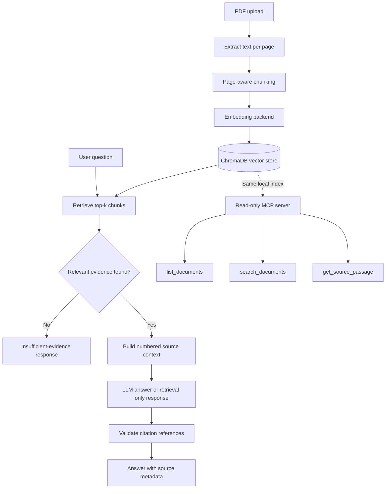

# KnowledgePilot AI — RAG-Powered PDF Knowledge Assistant

Ask questions about your PDFs and get answers backed by **verifiable source citations**. KnowledgePilot AI combines Retrieval-Augmented Generation (RAG), semantic retrieval, a Streamlit interface, evaluation tooling, and a read-only Model Context Protocol (MCP) server.

> **Core principle:** when the indexed documents do not provide enough evidence, the app can report insufficient evidence instead of guessing.

**Python · Streamlit · ChromaDB · PyMuPDF · sentence-transformers · MCP · pytest**

[Repository](https://github.com/devendra8861jee-data/knowledgepilot-ai) · [Architecture notes](docs/architecture.md) · [Demo workflow](docs/demo-workflow.md)

---

## At a glance

- Ingest text-based PDFs and preserve page metadata.
- Retrieve relevant chunks using a configurable embedding backend and relevance threshold.
- Return answers with source filename, physical PDF page number, and supporting excerpt.
- Validate citation markers against the retrieved source set.
- Use retrieval-only mode without an LLM API key.
- Explore indexed evidence through three read-only MCP tools.
- Run automated tests and an offline evaluation dataset.

## Screenshots

Screenshots are not included yet. Add **real screenshots from the running application** to `docs/images/` and then enable the image links below.

<!--
### Application


### Answer with citations


### Evaluation

-->

Suggested captures:
1. Main interface with a PDF indexed.
2. An answer with its source filename, page number, and excerpt visible.
3. The Evaluation tab with the metrics/results visible.

## How it works



### Citation handling

The generation step receives numbered retrieved sources. The application maps valid citation numbers back to the chunks it actually retrieved, so the filename, page, and excerpt come from stored metadata. Invalid citation numbers are removed and a warning can be shown; an answer without a valid citation is flagged as unverified.

**Page numbering:** citations use the physical page position in the PDF (page 1 is the first page, including a cover). When available, printed PDF page labels may also be shown.

## Technology stack

| Technology | Role |
|---|---|
| Python | Application and retrieval logic |
| Streamlit | Web interface for upload, chat, and evaluation |
| PyMuPDF | PDF text extraction |
| ChromaDB | Persistent vector storage |
| sentence-transformers | Semantic embedding backend |
| Hashing embedder | Lightweight offline/demo and test backend; lexical rather than semantic |
| OpenAI-compatible API | Optional answer generation |
| MCP Python SDK | Read-only tools for indexed document evidence |
| pytest | Unit, protocol, and integration tests |

## Getting started (Windows / PowerShell)

### Prerequisites

- Python 3.11 or 3.12 recommended for Windows
- Git
- Internet access for package installation and the first semantic-model download

### 1. Clone the repository

```powershell
git clone https://github.com/devendra8861jee-data/knowledgepilot-ai.git
cd knowledgepilot-ai
```

### 2. Create a virtual environment and install dependencies

```powershell
py -3.11 -m venv .venv
.\.venv\Scripts\python.exe -m pip install --upgrade pip
.\.venv\Scripts\python.exe -m pip install -r requirements-dev.txt
```

Using the virtual environment's Python directly avoids PowerShell activation-policy issues. Activation is optional.

> The `sentence-transformers` dependency can install PyTorch and download a model on first use. For an initial offline/lightweight test, select the `hashing` embedding backend in the app.

### 3. Configure environment variables

```powershell
Copy-Item .env.example .env
notepad .env
```

The example configuration uses `LLM_PROVIDER=none`, so you can start in retrieval-only mode without an API key. To generate LLM answers, configure a compatible provider in your private `.env` file.

**Security:** never commit `.env`, API keys, private PDFs, or your local vector database. The repository's `.gitignore` is intended to keep local secrets and data out of Git.

### 4. Run the application

```powershell
.\.venv\Scripts\python.exe -m streamlit run app.py
```

Open [http://localhost:8501](http://localhost:8501), upload a text-based PDF, ask a question grounded in the document, and inspect the sources.

### 5. Run the tests

```powershell
.\.venv\Scripts\python.exe -m pytest -v
```

The latest local verification recorded in this repository was **70 passed in 23.26 seconds** on Windows with Python 3.11 on October 23, 2026. Re-run the suite after code or dependency changes; this recorded result is not a guarantee for every machine.

To run focused MCP checks:

```powershell
.\.venv\Scripts\python.exe -m pytest tests\test_mcp_tools.py tests\test_mcp_protocol.py tests\test_mcp_integration.py -v
```

### 6. Run the evaluation

Offline evaluation with no model download or API key:

```powershell
.\.venv\Scripts\python.exe -m evaluation.run_evaluation --embedder hashing
```

Evaluation with semantic embeddings:

```powershell
.\.venv\Scripts\python.exe -m evaluation.run_evaluation --embedder sentence-transformers
```

Optional LLM answers and LLM-judged metrics require API configuration and may incur costs:

```powershell
.\.venv\Scripts\python.exe -m evaluation.run_evaluation --embedder sentence-transformers --use-llm --judge
```

Results are written to `evaluation/results/` locally and can be viewed in the app's Evaluation tab.

## MCP tools

The repository includes a read-only MCP stdio server using the same local ChromaDB index.

| Tool | Purpose |
|---|---|
| `list_documents` | List indexed documents |
| `search_documents` | Search indexed document content |
| `get_source_passage` | Retrieve a specific source passage |

Launch it from the repository root:

```powershell
.\.venv\Scripts\python.exe mcp_server.py
```

The server is designed to be launched by an MCP-compatible host, which communicates over standard input/output. It may wait silently when run directly in a terminal; that is expected. The tools retrieve evidence only—they do not call an LLM or independently generate answers.

## Evaluation metrics

The evaluation workflow supports:

- **Recall@K, Hit Rate@K, Precision@K, and MRR:** retrieval against labelled relevant file/page pairs.
- **Abstention behaviour:** correct abstention on unanswerable questions and false abstention on answerable questions.
- **Keyword coverage:** a rough lexical proxy, not a substitute for semantic evaluation.
- **Optional LLM-judged metrics:** faithfulness and relevance estimates that should be spot-checked by a person.
- **Operational metrics:** latency, error rate, tokens, and estimated cost when configured.

The bundled sample corpus is intentionally small. Its scores demonstrate that the evaluation pipeline runs; they should not be interpreted as a guarantee of performance on arbitrary real-world documents. Run evaluation on a representative dataset before drawing quality conclusions.

## Project structure

```text
knowledgepilot-ai/
├── app.py                      # Streamlit UI
├── config.py                   # Environment and application settings
├── mcp_server.py               # MCP stdio server entry point
├── requirements.txt            # Runtime dependencies
├── requirements-dev.txt        # Development dependencies, including pytest
├── .env.example                # Safe configuration template
├── src/
│   ├── ingestion.py            # PDF text extraction
│   ├── chunking.py             # Page-aware chunking
│   ├── embeddings.py            # Embedding backends
│   ├── vector_store.py         # ChromaDB integration
│   ├── retrieval.py             # Similarity search and thresholding
│   ├── generation.py            # Optional LLM generation
│   ├── citations.py             # Citation validation and source mapping
│   ├── pipeline.py              # Ingestion and question-answering pipeline
│   ├── evaluation.py            # Evaluation logic
│   └── mcp_server/             # Read-only MCP tools and server wiring
├── docs/                       # Architecture and demo documentation
├── evaluation/                 # Sample dataset and evaluation runner
├── tests/                      # Automated tests
└── data/                       # Local index data; not committed
```

## Configuration and LLM providers

The application supports providers exposing an OpenAI-compatible API. Provider endpoints and model names can change, so check the provider's current documentation before configuring them.

Example `.env` settings:

```ini
LLM_PROVIDER=openai_compatible
LLM_API_KEY=your_private_key
LLM_BASE_URL=https://api.openai.com/v1
LLM_MODEL=your-provider-model-name
```

Do not paste real secrets into README files, source code, issues, or commits. Keep the API key only in your local `.env` file.

## Known limitations

- Scanned or image-only PDFs need OCR before text extraction.
- Images and complex visual content inside PDFs are not interpreted.
- Each question is handled independently; retrieval conversation memory is not implemented.
- Chunks do not cross page boundaries, so text continuing onto the next page can be split.
- Retrieval quality depends on the embedding backend, threshold, and document collection.
- The hashing embedder is a lightweight lexical option, not a replacement for semantic embeddings.
- LLM-judged evaluation is an estimate and can be noisy.

## Roadmap

- [x] PDF ingestion and RAG retrieval
- [x] Evidence-backed answers and source citations
- [x] Streamlit interface and evaluation workflow
- [x] Read-only MCP tools
- [ ] Add screenshots from the running application
- [ ] Deploy a public demo
- [ ] Build a bounded research agent that uses MCP tools and treats document text as untrusted input

## Recruiter demo (about 3 minutes)

1. **Problem:** explain that the app grounds answers in uploaded PDFs and displays sources.
2. **Upload:** index the included sample handbook/manual documents.
3. **Cited answer:** ask a document-specific question and show the source filename, page, and excerpt.
4. **Insufficient evidence:** ask a question not answered by the PDF and demonstrate the fallback.
5. **Evaluation:** explain Recall@K and MRR, plus the limitations of a small sample corpus.
6. **Engineering:** show the test suite, configuration through `.env`, and read-only MCP tools.

## Troubleshooting

| Problem | What to try |
|---|---|
| PowerShell blocks `Activate.ps1` | Run the virtual environment's Python directly, as shown above; activation is optional. |
| Embedding model download fails | Check internet/proxy access, or choose the `hashing` backend for a lightweight test. |
| PDF contains no extractable text | OCR scanned PDFs first, then upload them again. |
| Insufficient evidence is returned | Confirm the PDF contains the answer, rephrase the question, or review the retrieval threshold and top-k settings. |
| Citation page differs from printed page | Citations use physical PDF page positions; printed page labels can differ. |
| `ModuleNotFoundError: src` | Run commands from the repository root. |
| API key rejected or rate limited | Check the private `.env` configuration and your provider's limits; never paste the key into logs or public issues. |

## Contributing

Issues, bug reports, and suggestions are welcome. Run the test suite before submitting changes and keep secrets, private documents, virtual environments, and generated local databases out of commits.

## License

No license is currently specified. Add a license file if you want to grant others explicit permission to reuse, modify, or distribute this project.
