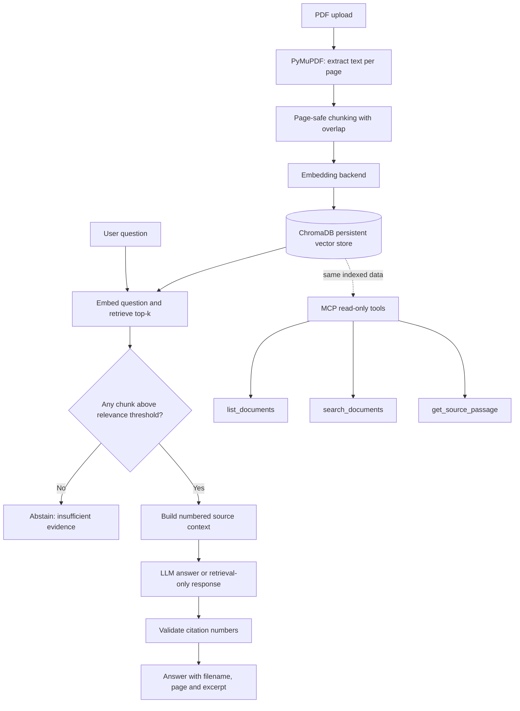

# KnowledgePilot AI - RAG Knowledge Assistant

Ask questions about your own PDFs and get answers backed by **verifiable citations**
(file name, page number, and the exact supporting excerpt). If the documents do not contain
enough evidence, the app says so instead of guessing.

**Phase 1:** PDF ingestion, semantic retrieval, cited answers, evaluation, Streamlit UI and tests.
**Phase 2:** read-only MCP tools for document listing, source search and exact passage retrieval.
The agent workflow is a later phase; the MCP tools return evidence and do not invent answers.

---

## Architecture



The Streamlit app handles PDF upload, chat and evaluation. The MCP stdio server exposes read-only tools over the same local index; an MCP host/client launches it and communicates over stdin/stdout. The MCP tools retrieve evidence but do not generate answers themselves.

**Why citations can be trusted:** the LLM only sees numbered sources and writes `[1]`, `[2]`. The app maps those numbers back to the chunks it really retrieved, so the file name, page and excerpt come from stored metadata. Numbers that do not exist are removed and a warning is shown. An answer without any valid citation is flagged as unverified.

See [`docs/architecture.md`](docs/architecture.md) for the expanded component diagram and [`docs/demo-workflow.md`](docs/demo-workflow.md) for a portfolio demo script.

**Why citations can be trusted:** the LLM only sees numbered sources and writes `[1]`, `[2]`.
The app maps those numbers back to the chunks it really retrieved, so the file name, page and
excerpt come from stored metadata. Numbers that do not exist are removed and a warning is shown.
An answer without any valid citation is flagged as unverified.

**Page numbers:** citations use the *physical* page position in the PDF file (page 1 = first page,
cover included). A document with a cover page or roman-numeral front matter may print a different
number on the page itself. When the PDF defines printed page labels, the label is shown too.

## Project structure

```
knowledgepilot-ai/
|-- app.py                      Streamlit UI (documents, chat, evaluation, help)
|-- mcp_server.py               MCP stdio server entry point
|-- config.py                   Settings from environment / .env (keys hidden from logs)
|-- requirements.txt            Runtime dependencies
|-- requirements-dev.txt        Adds pytest
|-- .env.example                Template for your private .env
|-- src/
|   |-- models.py               Dataclasses shared by all modules
|   |-- ingestion.py            PDF -> page text (scanned/empty/corrupt/encrypted handling)
|   |-- chunking.py             Page-safe chunking with overlap
|   |-- embeddings.py           sentence-transformers + offline "hashing" embedder
|   |-- vector_store.py         ChromaDB wrapper (one collection per embedding model)
|   |-- retrieval.py            Similarity search + relevance threshold
|   |-- generation.py           OpenAI-compatible LLM client, prompt, error mapping
|   |-- citations.py            [n] -> real filename/page/excerpt
|   |-- pipeline.py             ingest_pdf() and answer_question()
|   |-- evaluation.py           Metrics, dataset loader, LLM judge, report writer
|   `-- mcp_server/             Read-only MCP tool implementations and server wiring
|-- evaluation/
|   |-- sample_dataset.jsonl    15 labelled questions (12 answerable, 3 unanswerable)
|   |-- sample_docs/            2 small fictional PDFs the labels refer to
|   |-- make_sample_pdfs.py     Regenerates the sample PDFs
|   `-- run_evaluation.py       Evaluation command
|-- tests/                      pytest unit, protocol and integration tests
`-- data/                       Local vector database (not committed)
```

---

## Setup on Windows (PowerShell)

### 1. Install prerequisites
* **Python 3.11 or 3.12** from <https://www.python.org/downloads/> (tick *Add python.exe to PATH*).
* **Git** from <https://git-scm.com/download/win>.

### 2. Create a virtual environment and install packages
```powershell
cd path\to\knowledgepilot-ai
py -3.11 -m venv .venv
.\.venv\Scripts\python.exe -m pip install --upgrade pip
.\.venv\Scripts\python.exe -m pip install -r requirements-dev.txt
```
Using the virtual environment's Python directly avoids PowerShell activation-policy issues. If you prefer activation and your system allows it, run ` .\.venv\Scripts\Activate.ps1 ` and then use `python`/`pip` as usual.
`sentence-transformers` installs PyTorch (large download). To keep it small on a PC without a GPU:
`pip install torch --index-url https://download.pytorch.org/whl/cpu` *before* the line above.

### 3. Configure
```powershell
Copy-Item .env.example .env
notepad .env
```
No API key is required to try the app: keep `LLM_PROVIDER=none`.

### 4. Run the tests (offline, no API key, no model download)

If PowerShell blocks virtual-environment activation, you can call the venv's Python directly (no execution-policy change needed):

```powershell
.\.venv\Scripts\python.exe -m pytest -v
```

### 5. Run the MCP server (Phase 2)

Install dependencies from `requirements-dev.txt` first. The MCP server uses the same local Chroma database as the Streamlit app and exposes three read-only tools: `list_documents`, `search_documents`, and `get_source_passage`. It does not upload or delete files, and it does not call an LLM.

```powershell
python mcp_server.py
```

The stdio server is intended to be launched by an MCP host, so it may appear to wait silently in a terminal. That is normal: the host communicates with it over stdin/stdout. Do not type natural-language prompts directly into this terminal or redirect protocol stdout to a log file.

#### Automated MCP checks

Run the unit, in-memory protocol, and real stdio-client integration tests from the repository root:

```powershell
python -m pytest tests\test_mcp_tools.py tests\test_mcp_protocol.py tests\test_mcp_integration.py -v
```

`test_mcp_integration.py` launches `mcp_server.py` as a subprocess using the MCP Python client, initializes the protocol, discovers all three tools, and calls `list_documents`, `search_documents`, and `get_source_passage` against a temporary Chroma database. It sets `EMBEDDING_BACKEND=hashing`, so this test does not need a model download, API key, or access to your real `data` folder. The test needs the MCP SDK installed; it is skipped if `mcp` is not installed.

Run the full test suite with:

```powershell
python -m pytest -v
```

### 6. Run the app
```powershell
streamlit run app.py
```
Open <http://localhost:8501>. The first run with `sentence-transformers` downloads a ~90 MB model;
after that it works offline. To try the app without any download, choose the **hashing** backend in the sidebar.

### 7. Run the evaluation
```powershell
# Offline, no downloads, no key (lexical embedder):
python -m evaluation.run_evaluation --embedder hashing

# Real semantic embeddings (recommended for meaningful numbers):
python -m evaluation.run_evaluation --embedder sentence-transformers

# With answers and LLM-judged metrics (needs an API key, costs a few API calls):
python -m evaluation.run_evaluation --embedder sentence-transformers --use-llm --judge
```
Results are saved to `evaluation/results/latest.json` and `evaluation/results/human_review.csv`
and are shown in the app's **Evaluation** tab.

### 8. Git and GitHub

Review `.gitignore` before committing. Never commit `.env`, API keys, `.venv`, local uploaded PDFs, or the generated Chroma database. The repository keeps only `data/.gitkeep` in the local data folder.

```powershell
git init
git add .
git status          # verify .env and .venv are not staged
git commit -m "Build KnowledgePilot AI RAG assistant with MCP tools"
git branch -M main
git remote add origin https://github.com/<your-username>/knowledgepilot-ai.git
git push -u origin main
```

Replace `<your-username>` with your GitHub username. If `.env` was ever committed earlier, adding it to `.gitignore` does not remove it from Git history; revoke exposed keys and remove the secret from history before publishing.

---

## Getting an LLM API key (optional)

The app works with any provider that offers an **OpenAI-compatible** API. Put the values in `.env`
(never in code, never in Git):

| Provider | `LLM_BASE_URL` | Where to get a key |
|---|---|---|
| OpenAI | `https://api.openai.com/v1` | <https://platform.openai.com/api-keys> |
| Groq (has a free tier) | `https://api.groq.com/openai/v1` | <https://console.groq.com/keys> |
| Google Gemini (compat endpoint) | `https://generativelanguage.googleapis.com/v1beta/openai/` | <https://aistudio.google.com/apikey> |
| Ollama (local, free) | `http://localhost:11434/v1` | no key; set `LLM_API_KEY=ollama` |

```ini
LLM_PROVIDER=openai_compatible
LLM_API_KEY=<paste your key here>
LLM_BASE_URL=<from the table>
LLM_MODEL=<a model name from your provider's model list>
```
Model names and free-tier limits change over time; check your provider's documentation.
Restart the app after editing `.env`. The key is never displayed in the UI or logged.

---

## Evaluation: what is measured

| Group | Metrics | Needs | Trust level |
|---|---|---|---|
| **Ground-truth retrieval** | Recall@K, Hit rate@K, Precision@K, MRR | labelled (file, page) pairs | Objective, reproducible |
| **Lexical proxy** | Context keyword coverage | `expected_keywords` labels | Rough proxy only |
| **Abstention behaviour** | Correct abstention (unanswerable), false abstention (answerable) | `answerable` labels + threshold | Objective, threshold-dependent |
| **LLM-judged** | Faithfulness, answer relevance, context relevance | LLM key, `--judge` | Noisy estimate; spot-check by hand |
| **Operational** | Latency (mean, p95), error rate, tokens, estimated cost | pricing in `.env` for cost | Measured; cost is an estimate |
| **Human review** | Answer correctness vs `expected_answer` | a person | Fill `human_review.csv` |

A metric that was not computed is shown as `n/a`, never as a made-up number.

**Definitions.** A retrieved chunk is *relevant* if its (filename, page) is in the labelled list.
Recall@K = relevant pages found in the top K / relevant pages labelled. Precision@K = relevant chunks
in the top K / K. MRR = mean of 1 / rank of the first relevant chunk. Because each sample page is a
single chunk, Precision@4 is capped at 0.25 for single-page questions; this is a property of the tiny
corpus, not a bug.

### How to label your own dataset
Each line of a `.jsonl` file is one question:
```json
{"id": "q01", "question": "...", "expected_answer": "...",
 "relevant": [{"filename": "my_doc.pdf", "page": 7}],
 "expected_keywords": ["exact phrase on that page"], "answerable": true}
```
1. Open the PDF in a viewer and find the page that answers the question (physical page number).
2. Copy the exact filename, the page number, and 1-2 short phrases from that page into the JSON line.
3. Add unanswerable questions with `"answerable": false`, `"relevant": []` to test the fallback.
4. Put the PDFs in a folder and run `python -m evaluation.run_evaluation --dataset my.jsonl --docs-dir my_pdfs`.

### Measured results (this repository's sample data)

Measured on 2026-10-18 in a Linux sandbox with the **offline hashing embedder** (lexical, not semantic),
k=4, threshold 0.15, no LLM:

| Metric | Value |
|---|---|
| Recall@4 / Hit rate@4 | 1.000 / 1.000 |
| Precision@4 | 0.250 |
| MRR | 0.958 (q12 ranked second) |
| Keyword coverage in context | 1.000 |
| Correct abstention (3 unanswerable) | 0.667 (the "5G cellular backup" question scored 0.153, just above the threshold) |
| False abstention (12 answerable) | 0.000 |
| Mean retrieval latency | ~2 ms |

**Read these numbers carefully.** The corpus has only 7 chunks, so Recall@4 is easy to reach. They show
the pipeline works end to end; they are not a claim about real-world quality. Numbers for the
`sentence-transformers` embedder and for LLM-judged metrics were **not measured in the environment where
this was developed** (model downloads and LLM APIs were unreachable there). Run the commands above on
your machine and record your own results.

---

## Test status

**Latest local verification reported by the project owner:** `70 passed in 23.26s` on Windows, Python 3.11, on 2026-10-23. This includes the MCP stdio integration test. Re-run the suite on your own machine before relying on the result after any code or dependency changes:

```powershell
.\.venv\Scripts\python.exe -m pytest -v
```

The integration test launches the MCP server as a subprocess, initializes an MCP client session, discovers the three tools, and validates listing, search, and passage lookup against a temporary database. It does not prove answer quality for every possible PDF or question.

---

## Troubleshooting

| Problem | Fix |
|---|---|
| `Activate.ps1 cannot be loaded` | Use ` .\.venv\Scripts\python.exe -m pytest ` and ` .\.venv\Scripts\python.exe -m streamlit run app.py ` directly; activation is optional. |
| `streamlit` not recognised | Activate the venv first; or `python -m streamlit run app.py` |
| Embedding model download fails | Needs internet on first run. Behind a proxy set `HTTPS_PROXY`; or use the `hashing` backend to test |
| "contains no extractable text" | Scanned PDF. OCR it first (e.g. OCRmyPDF) and upload again |
| "password protected" | Remove the password and re-upload |
| Always "could not find sufficient evidence" | Lower *Minimum relevance score*, raise top-k, rephrase the question, or check the PDF has text |
| Answers cite the wrong page for you | Citations use physical PDF page numbers; printed numbers may differ (cover pages) |
| API key rejected / rate limit / timeout | Message appears in the chat; retrieved passages stay visible. Check `.env`, wait, retry |
| Changed chunk size had no effect | Chunking happens at indexing time; remove and re-upload the document |
| `ModuleNotFoundError: src` | Run commands from the project root folder |

## Verification checklist

The existing Phase 1 development notes recorded the following checks on 2026-10-18; rerun them on your own machine after changing dependencies or code:
- [x] Unit tests and offline evaluation were run in the original development environment.
- [x] Streamlit startup and a headless UI smoke test were checked in the original development environment.
- [x] LLM client error mapping was checked against a local fake server.
- [ ] Run `python -m pytest -v` on your machine and save the final pass/skip count.
- [ ] Run the MCP stdio integration test on Windows: `python -m pytest tests\test_mcp_integration.py -v`.

Please verify on your Windows machine (could not be verified where this was built):
- [ ] `pip install -r requirements-dev.txt` succeeds on Windows with Python 3.11.
- [ ] Upload `evaluation/sample_docs/acme_employee_handbook.pdf` in the UI, ask *"How many days of paid annual leave do employees get?"* and confirm the citation shows page 2 and the excerpt contains "24 days".
- [ ] Ask *"What is the CEO's salary?"* and confirm the fallback message appears.
- [ ] Run the evaluation with `--embedder sentence-transformers` and record the metrics.
- [ ] With a real API key: confirm an answer contains `[1]`-style markers and matching Sources expanders; try a wrong key and see a friendly error.
- [ ] Upload a scanned/image-only PDF and a renamed `.txt` file; confirm clear errors, no crash.
- [ ] Upload the same PDF twice (and once renamed); confirm "Already indexed".

## Recruiter demo script (about 3 minutes)

1. **Problem (20 s):** "LLMs hallucinate. This app only answers from uploaded PDFs and shows exactly where each claim came from."
2. **Upload (30 s):** Index the handbook and router manual together. Point out the per-file status and duplicate protection.
3. **Cited answer (40 s):** Ask "How many days per week may employees work remotely?" Open the Sources expander: file, page 3, excerpt. Open the retrieved-context debug view and show the scores.
4. **Honest failure (30 s):** Ask "What is the CEO's salary?" and show the "could not find sufficient evidence" fallback with the LLM never called.
5. **Multi-document (20 s):** Ask a router question; show the answer cites the manual, not the handbook.
6. **Evaluation (40 s):** Open the Evaluation tab. Explain Recall@K and MRR as ground-truth metrics, LLM-judged metrics as estimates, and human-reviewed correctness. Mention the tuned-threshold tradeoff (one unanswerable question slipped through).
7. **Engineering (20 s):** Show the automated tests (unit + MCP protocol + stdio integration), configuration through `.env`, and key handling (never logged or displayed).

## Roadmap

* **Phase 1:** RAG pipeline, citations, Streamlit UI, evaluation and tests.
* **Phase 2:** read-only MCP server exposing `list_documents`, `search_documents`, and `get_source_passage`, with bounded inputs and source metadata. The repository includes unit tests, an in-memory protocol test, and a real stdio-client integration test. Run them on the target Windows environment before describing that environment as verified.
* **Phase 3 (not started):** bounded research agent that uses the MCP tools and treats document text as untrusted data.

## Known limitations

* Text-only extraction: tables and images inside PDFs are not interpreted; scanned PDFs need OCR first.
* Each question is answered independently (no conversation memory in retrieval).
* Chunks never cross page boundaries, so a sentence that continues onto the next page is split.
* The relevance threshold depends on the embedding model and should be tuned per corpus.
