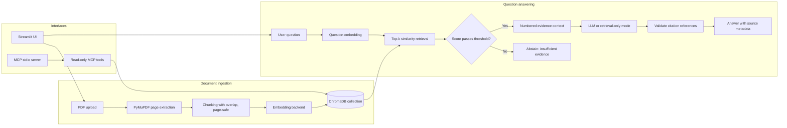

# KnowledgePilot AI — Architecture

## Main RAG path

## Components

- **`app.py`** — Streamlit UI for document upload, question answering, and evaluation.
- **`src/ingestion.py`** — extracts page-level text from PDFs and reports unsupported/empty inputs.
- **`src/chunking.py`** — splits text into overlapping chunks without crossing page boundaries.
- **`src/embeddings.py`** — sentence-transformers semantic embeddings or an offline hashing backend for tests.
- **`src/vector_store.py`** — persists and searches vectors in ChromaDB.
- **`src/retrieval.py`** — ranks candidate chunks and applies a relevance threshold.
- **`src/generation.py`** — optional OpenAI-compatible LLM call.
- **`src/citations.py`** — maps citation markers to retrieved chunk metadata and validates references.
- **`src/evaluation.py`** — retrieval, abstention, operational and optional LLM-judged metrics.
- **`src/mcp_server/tools.py`** — read-only MCP tools: `list_documents`, `search_documents`, and `get_source_passage`.
- **`mcp_server.py`** — stdio server entry point launched by an MCP host/client.

## Key design decisions

1. **Evidence before generation:** the app retrieves chunks before attempting an LLM answer.
2. **Abstention:** when no retrieved chunk passes the configured threshold, the app can return an insufficient-evidence response instead of asking the LLM to guess.
3. **Traceable citations:** file name, page and excerpt are resolved from retrieved metadata rather than invented by the model.
4. **Read-only MCP:** the tools search and retrieve existing indexed content; they do not upload or delete documents and do not generate answers.
5. **Offline tests:** tests use temporary data and the hashing embedder where appropriate, avoiding API keys and model downloads.

## Data flow at runtime

1. A PDF is parsed into page-specific text.
2. Text is chunked and embedded; vectors and metadata are persisted locally.
3. A question is embedded and compared with stored vectors.
4. Retrieved chunks are filtered by the configured relevance threshold.
5. The answer path either abstains or builds numbered evidence context for response generation.
6. Citation markers are validated and linked to real file/page/excerpt metadata.
